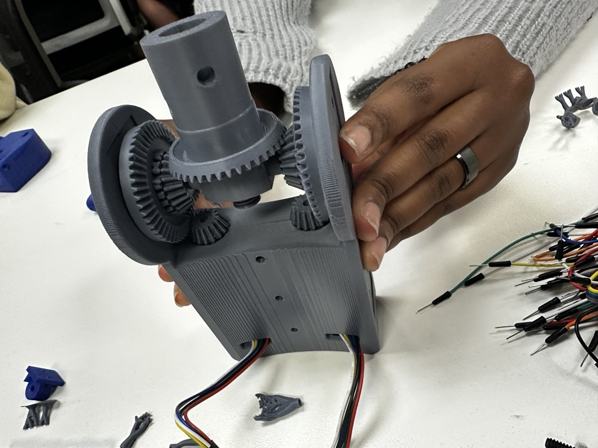
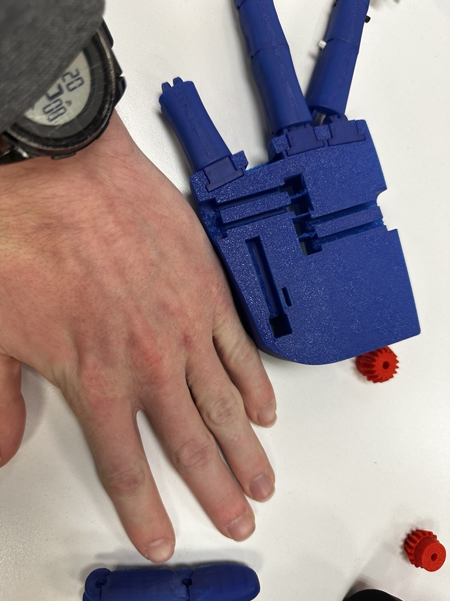
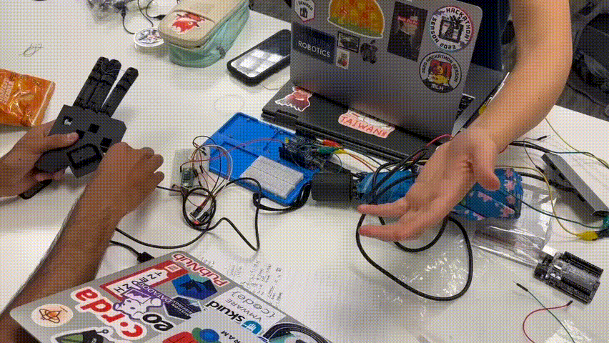
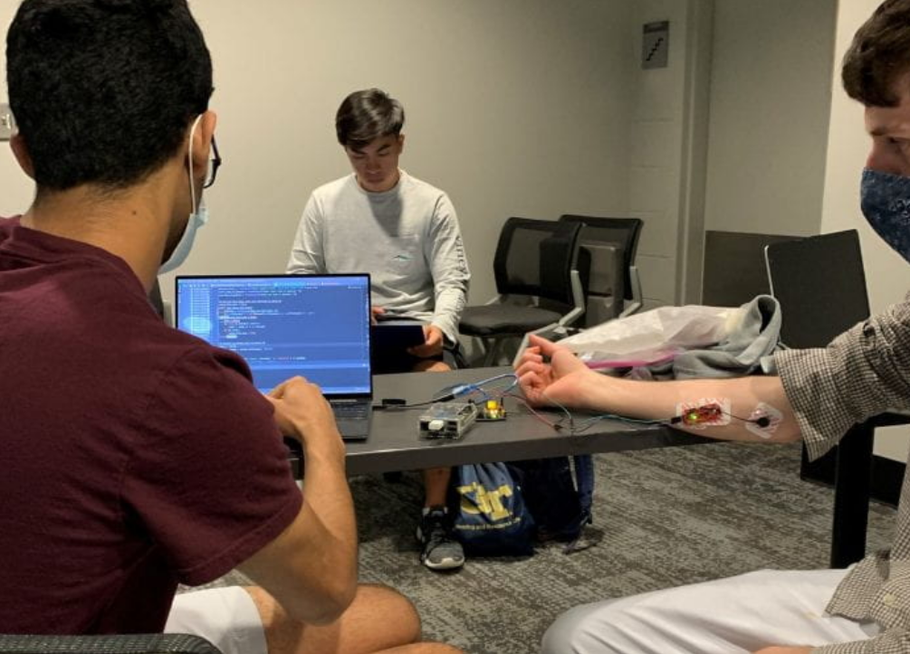

# Anthropomorphic-Robotic-Hand
Mechanical architecture for an anthropomorphic robotic hand built at Georgia Tech for prosthetic research. Packaged miniature DC actuators within an anatomical palm envelope, optimized multi-link finger kinematics, and integrated a 2-DOF opposable thumb. Validated fits via SLA/FDM prototyping for clinical amputee grasp evaluations.

##                        …  

  

# Anthropomorphic Prosthetic Hand

   
  <em>Figure 1: Fully Integrated Prosthetic Hand Assembly and Kinematic Model</em>

## GT Medical Robotics Club Team Limbo, Hand Mechanical Lead

Team Limbo developed a low-cost biomechatronic prosthetic hand for trans-radial amputees[cite: 1]. The goal was to build a functional, 5-digit underactuated terminal device that restores grasping capabilities without the high cost of commercial medical devices[cite: 1, 2, 3].

   
  <em>Figure 2: Parametric Digit Kinematics and Internal Palm Routing in Autodesk Fusion 360</em>

As the Mechanical Lead, I owned the mechanical architecture, CAD modeling, physical prototyping, and sensor integration[cite: 1, 2, 12]. I also worked with our controls team to validate the hardware for clinical testing with amputee participants[cite: 1]. Key contributions include:

### Parametric Modeling and Modular Digits
I modeled the full hand assembly in Autodesk Fusion 360 with parametric clearance fits for smooth cable movement[cite: 1, 2, 12]. The fingers were designed as modular units that pin directly into slots on the palm chassis[cite: 1, 6]. This setup lets us swap out a broken finger in under two minutes without taking apart the actuator carriage[cite: 1]. I also added internal pockets in the fingertips to house custom slip and force-sensing boards flush with the grip pads[cite: 1].

<table align="center" width="100%">
  <tr>
    <td align="center" width="50%">
       
      <em>3D-Printed Differential Bevel Wrist Mechanism</em>
    </td>
    <td align="center" width="50%">
       
      <em>FDM Anatomical Scale Model and Ergonomic Verification</em>
    </td>
  </tr>
</table>

<em>Figure 3: Kinematic Mechanisms: 2-DOF Differential Bevel Wrist (Left) and Anatomical Scale Check (Right)</em>

### Kinematic Synthesis and Wrist Articulation
To provide wrist articulation without adding excessive distal mass, I designed a 3D-printed differential bevel-gear wrist mechanism[cite: 2, 11]. The unit coordinates dual pinion inputs to achieve coupled 2-DOF pitch and roll movement in a compact footprint[cite: 2, 11]. This layout eliminates bulky dedicated joint housings and keeps the overall wrist length short enough to fit anatomical packaging limits[cite: 2, 11].

<table align="center" width="100%">
  <tr>
    <td align="center" width="50%">
       
      <em>Palm Actuator Assembly & Channeled Routing Layout</em>
    </td>
    <td align="center" width="50%">
       
      <em>Modular Digit Flexure and Tendon Anchorage</em>
    </td>
  </tr>
</table>

<em>Figure 4: Internal Hardware Packaging: Channeled Palm Chassis (Left) and Digit Flexure Mount (Right)</em>

### Iterative Prototyping and Tendon Routing
I iterated through several desktop FDM prints to check scale against real hands and dial in joint clearances[cite: 6, 9]. The palm chassis packages five linear DC actuators in a compact staggered layout[cite: 1]. I routed internal low-friction tendon channels with Delrin fairlead inserts[cite: 1]. This kept the cables from fraying, cut down on line friction, and ensured smooth finger return.

<table align="center" width="100%">
  <tr>
    <td align="center" width="50%">
       
      <em>Sensor Glove Teleoperation Test</em>
    </td>
    <td align="center" width="50%">
       
      <em>Forearm Surface EMG Data Acquisition</em>
    </td>
  </tr>
</table>

<em>Figure 5: Control Verification: Animated Sensor Glove Teleoperation (Left) and Forearm Surface EMG Testing (Right)</em>

### Control Integration, Endurance Testing, and Clinical Trials
We validated the hand across multiple testing pipelines. First, I used a flex-sensor data glove to teleoperate the hand in real time and verify finger curling speeds[cite: 10]. Next, we integrated the hardware with our forearm surface EMG setup[cite: 14]. Our software team used an LSTM model to classify muscle signals into open and close states[cite: 1]. I then ran an automated fatigue test on a microcontroller dyno rig, completing over 42,000 continuous grasp cycles without cable or joint failure[cite: 1]. The finished device transitioned into trials with amputee participants to evaluate real-world grasping tasks[cite: 1].
