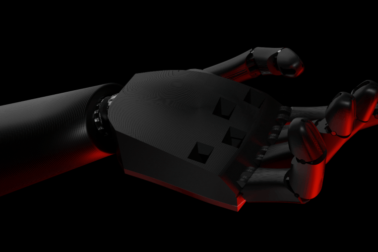
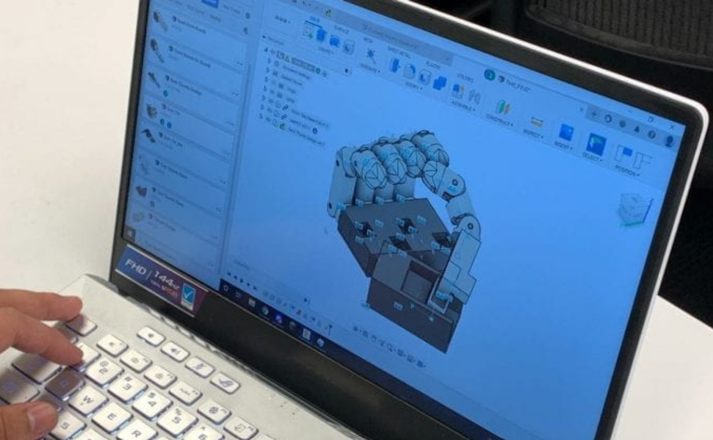

# Anthropomorphic-Robotic-Hand
Mechanical architecture for an anthropomorphic robotic hand built at Georgia Tech for prosthetic research. Packaged miniature DC actuators within an anatomical palm envelope, optimized multi-link finger kinematics, and integrated a 2-DOF opposable thumb. Validated fits via SLA/FDM prototyping for clinical amputee grasp evaluations.

##                        …  

  

# Anthropomorphic Prosthetic Hand

   
  <em>Figure 1: Fully Integrated Prosthetic Hand Assembly and Kinematic Model</em>

## GT Medical Robotics Club Team Limbo — Mechanical Lead

In developing a functional, low-cost biomechatronic prosthetic hand for trans-radial amputees, an underactuated, 5-digit anthropomorphic terminal device was engineered to restore intuitive grasping while bypassing cost-prohibitive clinical manufacturing.

   
  <em>Figure 2: Parametric Digit Kinematics and Internal Palm Routing in Autodesk Fusion 360</em>

As Mechanical Lead on Team Limbo, responsibilities included mechanical architecture, parametric CAD synthesis, prototype fabrication, sensor integration, and validating hardware for functional grasp evaluations with amputee participants. Key accomplishments:

### Parametric Modeling and Modular Digit Architecture:
Modeled the anatomical hand assembly in Autodesk Fusion 360, establishing parametric clearance tolerances for smooth tendon actuation and embedded electronics. Designed digits as modular sub-assemblies pinned into independent palm-chassis slots to enable single-digit replacements in under two minutes without disassembling the primary actuator carriage. Integrated recessed cavities in the distal fingertips to house custom micro-slip and force-sensing PCBs flush with the grip contact surface.

   
  <em>Figure 3: Kinematic Exploration — 3D-Printed Differential Bevel Wrist (Left) vs. CNC-Machined Worm Transmission Unit (Right)</em>

### Kinematic Synthesis & Transmission Exploration:
Explored competing actuation and transmission architectures to balance torque density and packaging limits. Synthesized a 3D-printed dual-input differential bevel-gear wrist unit providing coupled 2-DOF pitch and roll articulation within a compact envelope. Machined a dedicated benchtop worm-drive gearbox from 6061-T6 aluminum—featuring precision-machined bearing bores and a goBILDA 5203 planetary motor coupling—to benchmark high-reduction, non-backdrivable load transfer and inform joint torque design.

   
  <em>Figure 4: Fabrication Progression — FDM Anatomical Scale Model (Left) to Palm Actuator Routing Layout (Right)</em>

### Iterative Prototyping and Tendon Routing:
Evaluated kinematic ergonomics by iterating through desktop FDM scale prototypes to benchmark human hand proportions, joint clearance limits, and mechanical flexure paths. Refined the palm chassis to package five linear actuators in a compact staggered array, integrating routed low-friction tendon guide paths and Delrin fairlead inserts to eliminate line fraying, minimize mechanical hysteresis, and maintain smooth tension transfer.

   
  <em>Figure 5: Control Verification — Sensor-Glove Teleoperation (Left) and Forearm Surface EMG Data Acquisition (
